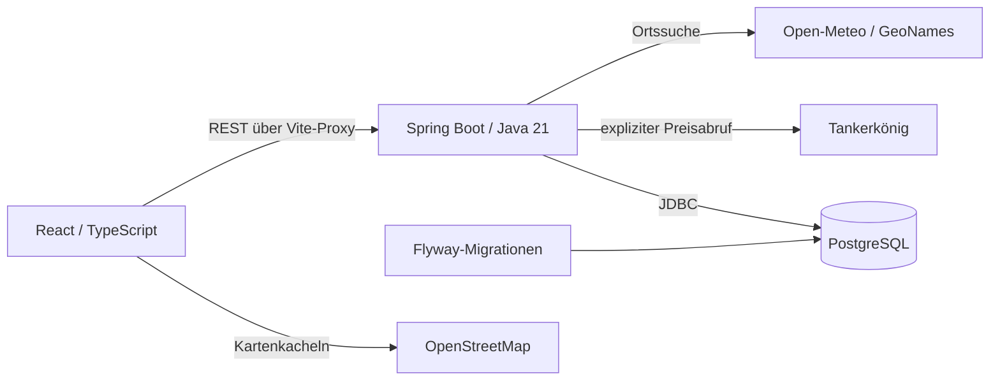
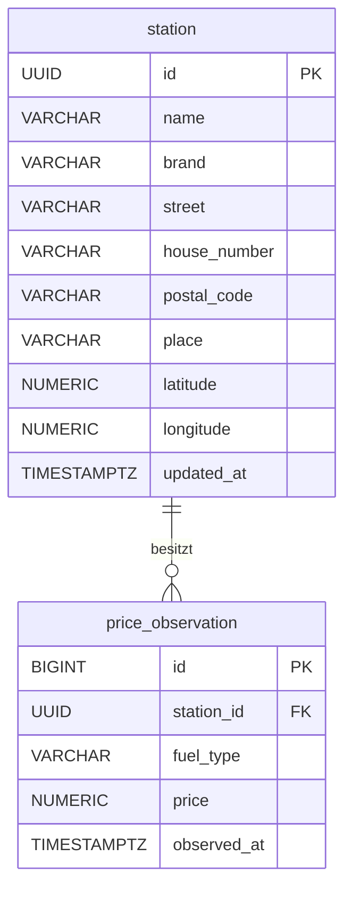

# Architektur und Datenmodell

## Ziel und Umfang

FuelAnalytics unterstützt den Vergleich von Tankstellenpreisen im gewählten
Umkreis. Nutzer suchen einen Ort, wählen Kraftstoff und Radius und vergleichen
Preise und Luftlinienentfernungen. Gespeicherte Beobachtungen ermöglichen
eine zeitliche Darstellung einzelner Tankstellen. Der lokale Prototyp richtet
sich an das Hochschulprojekt Datenmanagement und Visualisierung.

## Komponenten

Der Vite-Proxy leitet im Entwicklungsbetrieb `/api` an Port 8080 weiter.
API-Schlüssel bleiben im Backend. Das Frontend verwendet Leaflet für die Karte
und Recharts für den Preisverlauf. Nur Kartenkacheln werden direkt im Browser
vom Kartenanbieter geladen.

## Ablauf einer Suche

1. Die separate Ortssuche liefert passende Namen und Koordinaten. Nutzer müssen
   einen Treffer explizit auswählen; eine Textänderung verwirft diese Auswahl.
2. Der Preisabruf sendet Koordinaten und Radius an `POST /api/search`.
3. Das Backend prüft Eingaben und Mindestabstand zwischen Anbieterabrufen.
   Es fragt Tankerkönig außerhalb einer Datenbanktransaktion ab.
4. Der Mapper validiert Datensätze. Ungültige Tankstellen werden verworfen;
   fehlende Preise werden nicht als Null gespeichert.
5. Gültige Tankstellen und Preisbeobachtungen werden gemeinsam in einer
   Transaktion gespeichert. Bei einem Speicherfehler wird keine erfolgreiche
   Suchantwort zurückgegeben.
6. Das Frontend zeigt denselben Ergebnisstand in Liste, Übersicht und Karte.
   Sortierung und Kraftstoffwechsel erfolgen lokal. Der Verlauf liest über
   einen GET-Endpunkt die eigenen gespeicherten Beobachtungen.

## Datenmodell

`station` speichert die zuletzt abgerufenen Metadaten. Koordinaten haben sechs
Nachkommastellen und Bereichsprüfungen. Postleitzahlen sind Zeichenfolgen,
damit führende Nullen erhalten bleiben. Ein Index unterstützt die Ortsspalte.

`price_observation` speichert positive Preise als `NUMERIC(6,3)` und erlaubt
nur `diesel`, `e5` oder `e10`. Die Kombination aus Tankstelle, Kraftstoff und
Abrufzeitpunkt ist eindeutig. Ihr eindeutiger Index unterstützt die
Verlaufsabfrage nach Tankstelle, Kraftstoff und Zeitraum. Flyway verwaltet
Schemaänderungen; bestehende Migrationen werden nicht nachträglich verändert.

## Technologieentscheidungen

| Technologie | Zweck und Begründung im Projekt |
| --- | --- |
| Java 21 / Spring Boot | Typisierte Serverlogik, REST-Endpunkte, Konfiguration und Transaktionen |
| JDBC / PostgreSQL | Explizite SQL-Abfragen und relationale Integritätsregeln für Metadaten und Zeitreihen |
| Flyway | Versionierte, nachvollziehbare Schemaeinrichtung |
| React / TypeScript / Vite | Komponenten für Suche und Visualisierung, Typprüfung und lokale Entwicklungsumgebung |
| Leaflet / OpenStreetMap | Geografische Einordnung von Tankstellen und Suchradius |
| Recharts | Interaktive Darstellung zeitlich verteilter Preisbeobachtungen |
| Docker Compose | Einheitliche lokale PostgreSQL-Instanz mit persistentem Volume |

## Aussagegrenzen und Betrieb

`observed_at` bezeichnet den eigenen Abrufzeitpunkt, nicht eine bestätigte
Preisänderung. Es gibt derzeit keinen Hintergrundsammler. Lücken zwischen
Abrufen sind unbekannt; eine Diagrammlinie rekonstruiert keine Zwischenpreise.
Der Vergleich gewichtet jede verfügbare, beim Abruf geöffnete Tankstelle gleich
und ist kein repräsentativer regionaler Marktindex. Entfernungen sind Luftlinien.

Die Anwendung hat keine Benutzerverwaltung und ist kein fertiger öffentlicher
Dienst. Anbieterlimits werden pro Backend-Instanz verwaltet. Mehrere Instanzen
benötigen eine gemeinsame Begrenzung. Vor einer Veröffentlichung sind Betrieb,
HTTPS/Proxy, Zugriffsschutz und die Nutzungsbedingungen der Daten- und
Kartenanbieter gesondert zu klären. Automatische Datenbereinigung und ein
Backup-/Wiederherstellungsprozess sind noch nicht implementiert.
